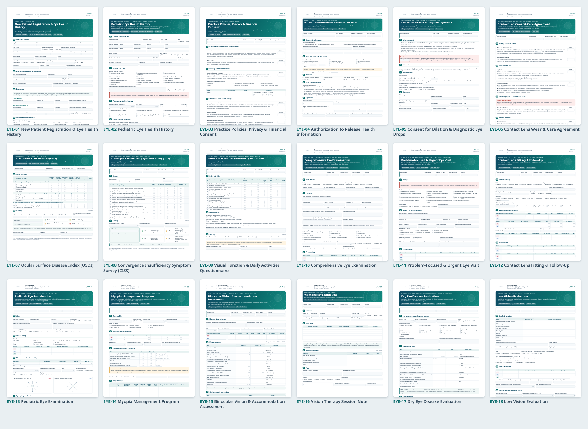
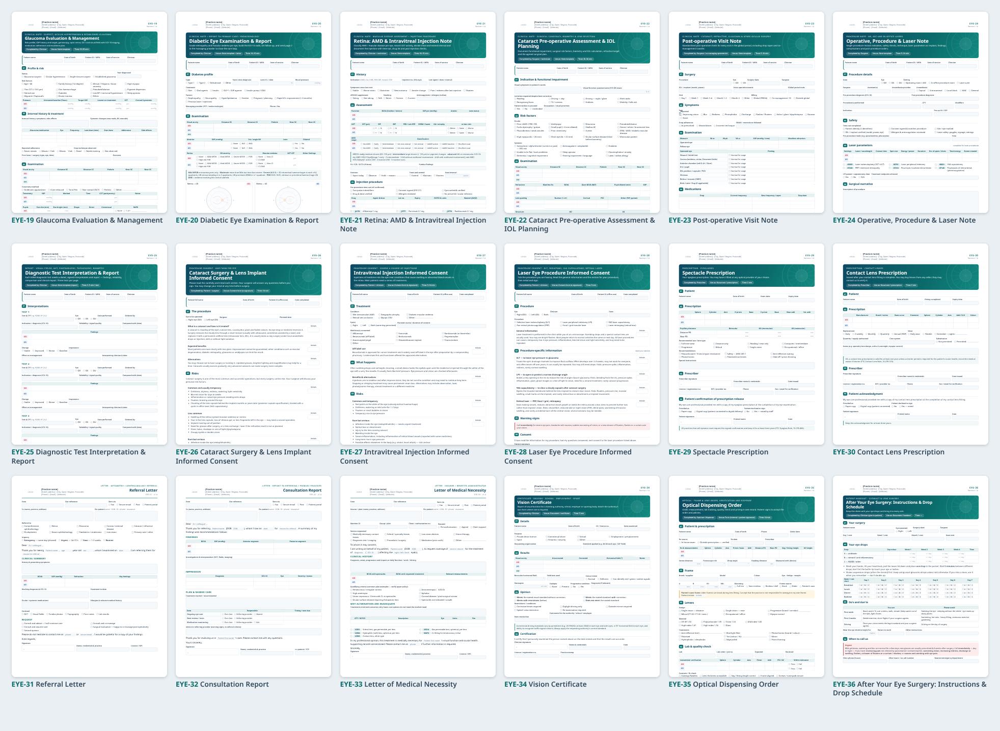

# Eye-Care Template Library for Carepatron

36 templates (70 Letter pages) for optometry and ophthalmology practices: intake forms, consents, scored questionnaires, clinical notes, prescriptions, letters, optical orders and patient handouts. Each one is a typed PDF with plain field labels, so it can go straight into **Carepatron → Templates → Import**. They also print well as paper forms.




## Library

### Intake, registration & practice consents

| Code | Template | Use as | Completed by | Pages |
|---|---|---|---|---|
| EYE-01 | [New Patient Registration & Eye Health History](pdf/EYE-01-new-patient-registration-eye-health-history.pdf) | Intake form (send via client portal) | Patient | 4 |
| EYE-02 | [Pediatric Eye Health History](pdf/EYE-02-pediatric-eye-health-history.pdf) | Intake form (send via client portal) | Parent / guardian | 2 |
| EYE-03 | [Practice Policies, Privacy & Financial Consent](pdf/EYE-03-practice-policies-privacy-financial-consent.pdf) | Consent form (e-signature) | Patient | 2 |
| EYE-04 | [Authorization to Release Health Information](pdf/EYE-04-authorization-release-health-information.pdf) | Consent form (e-signature) | Patient | 1 |
| EYE-05 | [Consent for Dilation & Diagnostic Eye Drops](pdf/EYE-05-consent-dilation-diagnostic-testing.pdf) | Consent form (e-signature) | Patient | 1 |
| EYE-06 | [Contact Lens Wear & Care Agreement](pdf/EYE-06-contact-lens-wear-agreement.pdf) | Consent form (e-signature) | Patient | 2 |

### Scored questionnaires

| Code | Template | Use as | Completed by | Pages |
|---|---|---|---|---|
| EYE-07 | [Ocular Surface Disease Index (OSDI)](pdf/EYE-07-osdi-dry-eye-questionnaire.pdf) | Assessment form with scoring | Patient | 1 |
| EYE-08 | [Convergence Insufficiency Symptom Survey (CISS)](pdf/EYE-08-ciss-convergence-insufficiency-symptom-survey.pdf) | Assessment form with scoring | Patient (or examiner with child) | 1 |
| EYE-09 | [Visual Function & Daily Activities Questionnaire](pdf/EYE-09-visual-function-daily-activities-questionnaire.pdf) | Assessment form with scoring | Patient | 1 |

### Clinical notes — primary eye care / optometry

| Code | Template | Use as | Completed by | Pages |
|---|---|---|---|---|
| EYE-10 | [Comprehensive Eye Examination](pdf/EYE-10-comprehensive-eye-examination.pdf) | Note template | Clinician + technician | 5 |
| EYE-11 | [Problem-Focused & Urgent Eye Visit](pdf/EYE-11-problem-focused-urgent-eye-visit.pdf) | Note template | Clinician | 3 |
| EYE-12 | [Contact Lens Fitting & Follow-Up](pdf/EYE-12-contact-lens-fitting-follow-up.pdf) | Note template | Clinician | 2 |
| EYE-13 | [Pediatric Eye Examination](pdf/EYE-13-pediatric-eye-examination.pdf) | Note template | Clinician | 3 |
| EYE-14 | [Myopia Management Program](pdf/EYE-14-myopia-management-program.pdf) | Note template | Clinician | 2 |
| EYE-15 | [Binocular Vision & Accommodation Assessment](pdf/EYE-15-binocular-vision-assessment.pdf) | Note template | Clinician | 2 |
| EYE-16 | [Vision Therapy Session Note](pdf/EYE-16-vision-therapy-session-note.pdf) | Note template (progress) | Clinician / vision therapist | 1 |
| EYE-17 | [Dry Eye Disease Evaluation](pdf/EYE-17-dry-eye-disease-evaluation.pdf) | Note template | Clinician + technician | 2 |
| EYE-18 | [Low Vision Evaluation](pdf/EYE-18-low-vision-evaluation.pdf) | Note template | Clinician | 2 |

### Clinical notes — medical & surgical ophthalmology

| Code | Template | Use as | Completed by | Pages |
|---|---|---|---|---|
| EYE-19 | [Glaucoma Evaluation & Management](pdf/EYE-19-glaucoma-evaluation-management.pdf) | Note template | Clinician | 3 |
| EYE-20 | [Diabetic Eye Examination & Report](pdf/EYE-20-diabetic-eye-examination-report.pdf) | Note template + letter | Clinician | 3 |
| EYE-21 | [Retina: AMD & Intravitreal Injection Note](pdf/EYE-21-retina-amd-intravitreal-injection-note.pdf) | Note template | Clinician + technician | 2 |
| EYE-22 | [Cataract Pre-operative Assessment & IOL Planning](pdf/EYE-22-cataract-preoperative-assessment.pdf) | Note template | Surgeon + technician | 3 |
| EYE-23 | [Post-operative Visit Note](pdf/EYE-23-post-operative-visit-note.pdf) | Note template | Surgeon / co-managing optometrist | 2 |
| EYE-24 | [Operative, Procedure & Laser Note](pdf/EYE-24-operative-procedure-laser-note.pdf) | Note template | Surgeon | 2 |
| EYE-25 | [Diagnostic Test Interpretation & Report](pdf/EYE-25-diagnostic-test-interpretation-report.pdf) | Note template (report) | Clinician | 2 |

### Procedure consents

| Code | Template | Use as | Completed by | Pages |
|---|---|---|---|---|
| EYE-26 | [Cataract Surgery & Lens Implant Informed Consent](pdf/EYE-26-cataract-surgery-iol-informed-consent.pdf) | Consent form (e-signature) | Patient + surgeon | 3 |
| EYE-27 | [Intravitreal Injection Informed Consent](pdf/EYE-27-intravitreal-injection-informed-consent.pdf) | Consent form (e-signature) | Patient + clinician | 2 |
| EYE-28 | [Laser Eye Procedure Informed Consent](pdf/EYE-28-laser-procedure-informed-consent.pdf) | Consent form (e-signature) | Patient + clinician | 2 |

### Prescriptions, letters & certificates

| Code | Template | Use as | Completed by | Pages |
|---|---|---|---|---|
| EYE-29 | [Spectacle Prescription](pdf/EYE-29-spectacle-prescription.pdf) | Document / prescription | Prescriber | 1 |
| EYE-30 | [Contact Lens Prescription](pdf/EYE-30-contact-lens-prescription.pdf) | Document / prescription | Prescriber | 1 |
| EYE-31 | [Referral Letter](pdf/EYE-31-referral-letter.pdf) | Letter template | Clinician | 1 |
| EYE-32 | [Consultation Report](pdf/EYE-32-consultation-report-referring-provider.pdf) | Letter template | Clinician | 1 |
| EYE-33 | [Letter of Medical Necessity](pdf/EYE-33-letter-of-medical-necessity.pdf) | Letter template | Clinician | 1 |
| EYE-34 | [Vision Certificate](pdf/EYE-34-vision-certificate-driving-school-work.pdf) | Document / certificate | Clinician | 1 |

### Optical & patient handouts

| Code | Template | Use as | Completed by | Pages |
|---|---|---|---|---|
| EYE-35 | [Optical Dispensing Order](pdf/EYE-35-optical-dispensing-order.pdf) | Form (internal + patient signature) | Optician / dispenser | 2 |
| EYE-36 | [After Your Eye Surgery: Instructions & Drop Schedule](pdf/EYE-36-post-operative-instructions-drop-schedule.pdf) | Document / handout | Clinician (give to patient) | 1 |

## Importing into Carepatron

1. **Templates → Import**, then drag in the PDF. Carepatron maps fields from the labels. Typed PDFs with clearly labelled fields map best ([Importing templates](https://help.carepatron.com/en/articles/11429252-importing-templates)).
2. Check the mapped structure. Rename fields, remove sections you don't use, and set field types where the import guessed wrong. Grids map most cleanly to tables or to grouped short-answer fields, with OD and OS as separate rows.
3. Replace the patient-strip fields (name, DOB, date) with **smart chips**, which auto-fill from the client profile ([Capture a clinical note](https://learn.carepatron.com/courses/run-a-session/capture-note/)).
4. For **EYE-07 OSDI, EYE-08 CISS and EYE-09**, turn on assessment scoring so totals calculate as the form is filled in ([Scoring assessments](https://help.carepatron.com/en/articles/14696768-scoring-assessments-in-carepatron)). Each form prints its formula and interpretation bands.
5. Patient-completed forms (EYE-01 to EYE-09 and the consents) can be sent through the client portal before the visit. Confirm the signature fields came through as Carepatron signature fields.

**Suggested setup:** make EYE-10 your one master note for routine visits. Add EYE-11 to EYE-25 only for work that really is different (urgent, contact lenses, paediatric, glaucoma, retina, surgical). This follows Carepatron's own guidance on template libraries ([Template library architecture](https://learn.carepatron.com/playbooks/template-library-architecture/)).

## Before going live

- **Practice details.** Every header shows `[Practice name]` and contact placeholders. Edit the `_header` method in `src/render.py` and rebuild, or replace the details after import.
- **Fees and policies.** Fill in the grey `{{…}}` placeholders (fees, days, hours) in EYE-03, EYE-06, EYE-26, EYE-35 and EYE-36.
- **Jurisdiction.** Codes are US (CPT, ICD-10-CM, HCPCS). The prescription-release confirmations follow the FTC [Eyeglass Rule](https://www.ftc.gov/business-guidance/blog/2024/06/specs-specs-what-eye-doctors-need-know-about-ftcs-revised-eyeglass-rule) and Contact Lens Rule. Codes, payer edits and J-codes change every year, so check them against current references. Have your own counsel or indemnity provider review consent wording for your region.
- **Instruments.** OSDI is © Allergan; confirm the licence terms before commercial or research use. CISS is from the CITT group. EYE-09 is a documentation aid and has no validated cut-off. Binocular-vision norms in EYE-15 are population guides (Morgan, Hofstetter, Scheiman & Wick).

## Editing and rebuilding

Templates are defined in Python, one module per group in `src/templates/`. Shared clinical blocks live in `common.py` and layout components in `render.py`. The build needs only Python 3.9+ and Chrome or Chromium; no packages are required.

```bash
python3 src/build.py                 # all templates + catalog previews
python3 src/build.py EYE-10 EYE-19   # selected templates
CHROME="/path/to/chrome" python3 src/build.py
```

The PDFs embed Noto Sans. Symbols such as ≥ ≤ → ✓ come from Source Code Pro (SIL OFL 1.1, see `src/fonts/OFL.txt`).
